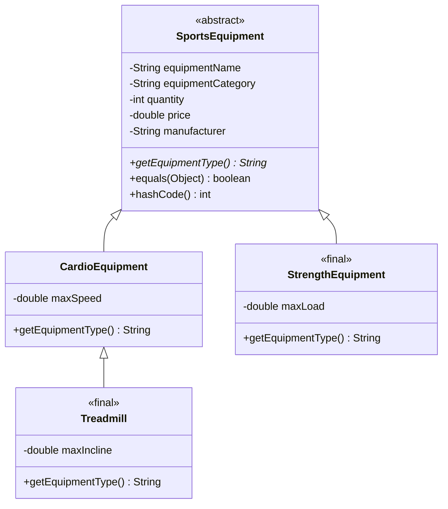

# Java2026

Laboratory works for Java

---

## 🏋️ Лабораторна робота №1

### Предметна область

Консольний застосунок для ведення обліку спортивного інвентарю.

### Сутність: Спортивний інвентар

| Характеристика | Тип | Опис |
|:---|:---:|:---|
| `equipmentName` | `String` | Назва спортивного інвентарю |
| `equipmentCategory` | `String` | Категорія інвентарю |
| `quantity` | `int` | Кількість одиниць інвентарю |
| `price` | `double` | Ціна за одну одиницю |
| `manufacturer` | `String` | Виробник інвентарю |

---

### ⚙️ Обчислювальні операції

**Загальна вартість інвентарю** визначається шляхом множення кількості одиниць на ціну однієї одиниці:

`totalCost = quantity × price`

Також програма перевіряє наявність спортивного інвентарю за його кількістю:

- якщо `quantity > 0` — інвентар є в наявності;
- якщо `quantity = 0` — інвентар відсутній.

---

### 🖥️ Форматування виводу

Для виведення інформації про спортивний інвентар використовується `System.out.printf`.

Для значень типу `double` використовується формат `%.2f`, який забезпечує відображення двох знаків після крапки.

Основні формати, використані у програмі:

| Формат | Призначення |
|:---:|:---|
| `%s` | Виведення текстового значення `String` |
| `%d` | Виведення цілого числа `int` |
| `%.2f` | Виведення дробового числа з двома знаками після крапки |
| `%n` | Перехід на новий рядок |

---

### 🚀 Запуск

Для компіляції та запуску застосунку необхідно відкрити термінал у папці проєкту та виконати команди:

```bash
javac -encoding UTF-8 Main.java
java Main
```

Команда `javac` використовується для компіляції Java-файлу, а команда `java` — для запуску скомпільованої програми.

---

### 📝 Приклад вводу

Назва інвентарю: Баскетбольний м'яч

Категорія: М'ячі

Кількість: 8

Ціна за одиницю: 750

Виробник: Spalding

---

### 📋 Приклад виводу

```text
=== СПОРТИВНИЙ ІНВЕНТАР ===

Назва: Баскетбольний м'яч
Категорія: М'ячі
Кількість: 8
Ціна за одиницю: 750.00 грн
Виробник: Spalding
Загальна вартість: 6000.00 грн
Інвентар є в наявності.
```

---

### 🛠️ Технології

- **Java** — мова програмування для реалізації консольного застосунку.
- **Scanner** — використовується для введення даних користувачем.
- **Git** — система контролю версій.
- **GitHub** — платформа для зберігання та роботи з репозиторієм.

---

## 🏋️ Лабораторна робота №2

### Предметна область

Консольний застосунок для ведення обліку спортивного інвентарю з використанням масивів, циклів, сортування та пошуку.

### 📦 Клас `SportsEquipment`

Для представлення спортивного інвентарю створено клас `SportsEquipment`.

Клас містить такі поля:

| Характеристика | Тип | Опис |
|:---|:---:|:---|
| `equipmentName` | `String` | Назва спортивного інвентарю |
| `equipmentCategory` | `String` | Категорія інвентарю |
| `quantity` | `int` | Кількість одиниць інвентарю |
| `price` | `double` | Ціна за одну одиницю |
| `manufacturer` | `String` | Виробник інвентарю |

Для створення об'єктів використовується конструктор класу.

Метод `toString()` використовується для зручного виведення інформації про об'єкт.

Метод `equals()` використовується для порівняння двох об'єктів `SportsEquipment` за їхніми характеристиками.

---

### 🔢 Масив об'єктів

У програмі створюється масив із 5 об'єктів `SportsEquipment`.

Заповнення масиву виконується за допомогою циклу `for`, а введення даних здійснюється через `Scanner`.

Для виведення всіх елементів масиву використовується цикл `for-each`.

---

### 📊 Підрахунок елементів

Програма підраховує кількість позицій спортивного інвентарю, для яких кількість одиниць не перевищує 5.

---

### 🔄 Сортування

Реалізовано сортування масиву методом бульбашки (**Bubble Sort**).

Інвентар сортується за ціною від меншої до більшої.

Сортування виконується без використання `Arrays.sort()`.

Перед та після сортування масив виводиться на екран.

---

### 🔎 Пошук

Реалізовано лінійний пошук спортивного інвентарю.

Метод `findEquipment()` отримує масив об'єктів та об'єкт для пошуку і послідовно порівнює елементи за допомогою методу `equals()`.

Якщо відповідний об'єкт знайдено, метод повертає `true`, інакше — `false`.

---

### 🚀 Запуск

Для компіляції та запуску застосунку необхідно відкрити термінал у папці проєкту та виконати команди:

```bash
javac -encoding UTF-8 Main.java SportsEquipment.java
java Main
```

---

### 🛠️ Технології

- **Java** — мова програмування для реалізації консольного застосунку.
- **Scanner** — використовується для введення даних користувачем.
- **Масиви** — використовуються для зберігання об'єктів спортивного інвентарю.
- **Цикли `for` та `for-each`** — використовуються для заповнення, обробки та виведення масиву.
- **Bubble Sort** — використовується для сортування інвентарю за ціною.
- **Лінійний пошук** — використовується для пошуку об'єкта в масиві.
- **Git** — система контролю версій.
- **GitHub** — платформа для зберігання та роботи з репозиторієм.

## Лабораторна робота №3

### Тема
Реалізація обробки винятків та створення власних підкласів Exception.

### Реалізовано

- обробку стандартного винятку `InputMismatchException`;
- обробку `ArrayIndexOutOfBoundsException`;
- використання конструкцій `try-catch-finally`;
- створення власного базового винятку `DomainException`;
- створення власного винятку `InvalidPriceException`;
- створення власного винятку `InsufficientStockException`;
- перевірку коректності ціни та кількості спортивного інвентарю;
- використання `throw` та `throws`;
- реалізацію повторного викидання винятку (`rethrow`);
- ієрархію власних винятків;
- використання кількох блоків `catch`;
- демонстрацію обробки винятків у програмі обліку спортивного інвентарю.

### Перевірені ситуації

1. Некоректне введення кількості або ціни.
2. Звернення до елемента масиву за межами його розміру.
3. Введення від'ємної ціни.
4. Введення нульової або від'ємної кількості.
5. Передача та повторне викидання власних винятків.
6. Обробка дочірніх винятків через базовий `DomainException`.

---

## 🏋️ Лабораторна робота №4

### Тема

Реалізація інтерфейсів, абстрактних класів, поліморфізму та патерна проєктування Strategy.

### 🎯 Мета роботи

Ознайомитися з інтерфейсами та абстрактними класами в Java, навчитися використовувати поліморфізм, реалізовувати кілька інтерфейсів і застосовувати патерн Strategy для зміни поведінки програми під час виконання.

### 📦 Інтерфейс `StockCheck`

Створено інтерфейс `StockCheck`, який визначає контракт для перевірки стану спортивного інвентарю.

Інтерфейс містить такі методи:

- `check(SportsEquipment item)` — перевіряє, чи відповідає інвентар певній умові;
- `getDescription()` — метод `default`, який повертає опис перевірки та може бути перевизначений у класах реалізації.

### 🔍 Реалізації інтерфейсу

Реалізовано два класи:

| Клас | Призначення |
|:---|:---|
| `LowStockCheck` | Перевіряє, чи кількість інвентарю більша за 0 та не перевищує встановлену межу `LOW_STOCK_LIMIT`. |
| `OutOfStockCheck` | Перевіряє, чи кількість інвентарю дорівнює 0. |

Обидва класи перевизначають метод `getDescription()` для відображення власного опису перевірки.

### 🔄 Поліморфізм

Для демонстрації поліморфізму створено масив `StockCheck[]`, який містить об'єкти різних реалізацій інтерфейсу.

У циклі викликається метод `check()` для кожної реалізації. Поведінка методу залежить від конкретного об'єкта.

### 🧩 Абстрактний клас `AbstractStockCheck`

Створено абстрактний клас `AbstractStockCheck`, який реалізує інтерфейс `StockCheck` та містить спільний метод `printResult()`.

Метод виконує перевірку спортивного інвентарю та виводить результат. Конкретні класи успадковують цей метод, але реалізують власні правила перевірки.

### 📋 Інтерфейс `Reportable`

Створено інтерфейс `Reportable` із методом `getReportName()`, який повертає коротку назву перевірки для звіту.

Класи `LowStockCheck` та `OutOfStockCheck` реалізують цей інтерфейс додатково до успадкування від `AbstractStockCheck`.

### ⚙️ Патерн Strategy

Реалізовано патерн проєктування Strategy за допомогою класу `StockChecker`.

Клас містить такі можливості:

- отримання початкової стратегії через конструктор;
- зберігання поточної стратегії через інтерфейс `StockCheck`;
- виконання перевірки за допомогою методу `check()`;
- отримання опису поточної стратегії через `getDescription()`;
- зміна стратегії під час виконання програми за допомогою `setStrategy()`.

Для демонстрації патерна спочатку використовується `LowStockCheck`, після чого стратегія змінюється на `OutOfStockCheck`.

### ✅ Перевірка роботи

Під час тестування використано п'ять позицій спортивного інвентарю.

Очікувані результати:

- кількість позицій із малою кількістю — 2;
- кількість позицій, відсутніх у наявності, — 1;
- для товару з кількістю 3 результат `LowStockCheck` — `true`;
- для того самого товару результат `OutOfStockCheck` — `false`.

### 🚀 Запуск

Для компіляції всіх Java-файлів у папці проєкту та запуску програми необхідно виконати команди:

```bash
javac *.java
java Main
```

### 🛠️ Технології та засоби

- **Java** — мова програмування.
- **Інтерфейси** — визначення контрактів поведінки класів.
- **Абстрактні класи** — реалізація спільної логіки.
- **Поліморфізм** — використання різних реалізацій через спільний тип.
- **Strategy** — зміна алгоритму перевірки під час виконання програми.
- **Git** — система контролю версій.
- **GitHub** — платформа для зберігання та спільної роботи з репозиторієм.


## 🏋️ Лабораторна робота №5

### Тема

Рефакторинг програмного коду із застосуванням патернів проєктування Factory, Observer та Adapter.

### 🎯 Мета роботи

Покращити архітектуру наявного консольного застосунку для обліку спортивного інвентарю шляхом застосування патернів проєктування та рефакторингу коду лабораторних робіт №1–4.

### 🏭 Патерн Factory

Для створення об'єктів перевірки стану запасів реалізовано клас `StockCheckFactory`.

Метод `createCheck(String type)` приймає тип перевірки та повертає відповідний об'єкт:

- `low` — створює `LowStockCheck`;
- `out` — створює `OutOfStockCheck`;
- невідомий тип спричиняє `IllegalArgumentException`.

Завдяки фабриці клієнтський код звертається до єдиного методу створення об'єктів, а не створює ці перевірки безпосередньо в кожному місці використання.

### 👁️ Патерн Observer

Для демонстрації сповіщення про зміну кількості спортивного інвентарю реалізовано такі класи та інтерфейси:

| Клас / інтерфейс | Призначення |
|:---|:---|
| `StockObserver` | Інтерфейс спостерігача з методом `onStockChanged()`. |
| `StockSubject` | Зберігає список спостерігачів і повідомляє їх про зміну кількості інвентарю. |
| `LowStockObserver` | Повідомляє про малу кількість інвентарю. |
| `StockLogObserver` | Виводить повідомлення про зміну кількості в журналі. |

Метод `changeQuantity()` змінює кількість інвентарю та повідомляє всіх підписаних спостерігачів, якщо значення змінилося.

Робота патерна демонструється на тестовому об'єкті спортивного інвентарю, щоб не змінювати основні дані, введені користувачем.

### 🔌 Патерн Adapter

Для демонстрації адаптації несумісних інтерфейсів реалізовано такі класи:

| Клас | Призначення |
|:---|:---|
| `LegacyStockChecker` | Імітує застарілий компонент, який перевіряє наявність інвентарю за числовою кількістю. |
| `LegacyStockCheckAdapter` | Адаптує застарілий компонент до інтерфейсу `StockCheck`. |

Адаптер реалізує метод `check(SportsEquipment item)` і передає кількість інвентарю до методу `isOutOfStock(int quantity)` класу `LegacyStockChecker`.

Несумісний клас не змінюється. Для зв'язку між компонентами використовується композиція.

### ✅ Перевірка роботи

Після внесення змін перевірено компіляцію та запуск програми.

Під час виконання демонструються:

- створення перевірок запасів за допомогою фабрики;
- сповіщення двох спостерігачів про зміну кількості тестового інвентарю;
- перевірка наявності інвентарю через адаптер;
- робота наявних можливостей застосунку, зокрема перевірок запасів і патерна Strategy.

### 🚀 Компіляція та запуск

Усі команди потрібно виконувати в терміналі з кореневої папки проєкту.

Компіляція:

```bash
javac -encoding UTF-8 -d out -sourcepath src Main.java src/*.java
```

Запуск:

```bash
java "-Dfile.encoding=UTF-8" -cp out Main
```

### 🛠️ Технології та засоби

- **Java** — мова програмування.
- **Інтерфейси та поліморфізм** — спільний контракт для різних реалізацій.
- **Factory** — централізоване створення об'єктів перевірки.
- **Observer** — сповіщення підписників про зміну стану.
- **Adapter** — узгодження несумісних інтерфейсів.
- **Strategy** — зміна алгоритму перевірки під час виконання програми.
- **Git** — система контролю версій.
- **GitHub** — платформа для зберігання репозиторію та роботи з Pull Request.

---

## 🏋️ Лабораторна робота №6

### Тема

Реалізація ієрархії класів, наслідування, поліморфізму, перевантаження конструкторів, `equals()`, `hashCode()` та pattern matching у Java.

### 🎯 Мета роботи

Закріпити навички об'єктноорієнтованого програмування, навчитися створювати ієрархії класів, використовувати абстрактні та запечатані класи, перевизначати методи `equals()` і `hashCode()`, а також застосовувати pattern matching.

### 📦 Ієрархія класів

У програмі реалізовано такі класи:

- `SportsEquipment` — абстрактний базовий клас зі спільними полями спортивного інвентарю.
- `CardioEquipment` — клас кардіотренажерів, який містить поле `maxSpeed`.
- `StrengthEquipment` — клас силового обладнання, який містить поле `maxLoad`.
- `Treadmill` — клас бігових доріжок, який успадковує `CardioEquipment` і містить поле `maxIncline`.

Спільні поля оголошено як `private`. Для ініціалізації успадкованих полів використовується `super(...)`, а для перевизначення методів — анотація `@Override`.

### 🔒 Ключові слова `abstract`, `sealed` і `final`

- `abstract` означає, що базовий клас не призначений для безпосереднього створення об'єктів.
- `sealed` обмежує перелік класів, які можуть безпосередньо успадковувати клас.
- `permits` визначає дозволені підкласи.
- `final` забороняє подальше успадкування класу.

У цій ієрархії `SportsEquipment` дозволяє успадкування класам `CardioEquipment` і `StrengthEquipment`. Клас `CardioEquipment` дозволяє успадкування лише класу `Treadmill`. Класи `StrengthEquipment` і `Treadmill` є `final`.

### 🔧 Перевантаження конструкторів

У класі `CardioEquipment` реалізовано два конструктори: один приймає спільні параметри, а інший додатково приймає максимальну швидкість.

Для повторного використання коду застосовується `this(...)`, який викликає інший конструктор цього самого класу.

Виклик `super(...)` передає спільні параметри базовому класу. Порядок виконання конструкторів демонструється повідомленнями в консолі.

### 🔄 Поліморфізм і pattern matching

Для роботи з різними видами інвентарю використовується спільний тип `SportsEquipment`.

У програмі демонструються:

- `instanceof` із pattern matching для визначення конкретного типу об'єкта;
- `switch` із pattern matching для отримання інформації про відповідний вид обладнання;
- використання специфічних методів підкласів безпосередньо після перевірки типу.

### ⚖️ Методи `equals()` і `hashCode()`

Метод `equals()` порівнює об'єкти за значеннями їхніх полів, а `hashCode()` обчислює хеш-код об'єкта.

Метод `equals()` використовує `getClass()` для перевірки однаковості фактичних типів об'єктів. Це запобігає порівнянню об'єктів різних класів як рівних.

Для перевірки створюються два однакові об'єкти `Treadmill`. Програма демонструє результати порівняння в обох напрямках і перевіряє збіг хеш-кодів.

### 🧩 Композиція та наслідування

Композиція використовується в патерні Adapter: `LegacyStockCheckAdapter` містить об'єкт `LegacyStockChecker` і делегує йому перевірку.

Цей підхід дозволяє використовувати застарілий компонент без зміни його класу. Наслідування застосовується там, де класи справді є спеціалізованими видами спортивного інвентарю.

### 📊 Діаграма класів



### 🚀 Компіляція та запуск

Команди виконуються в кореневій папці проєкту `E:\Java2026`.

Компіляція:

```powershell
javac -encoding UTF-8 -d out Main.java src\*.java
```

Запуск:

```powershell
java -cp out Main
```

### 🛠️ Технології та засоби

- **Java** — мова програмування.
- **Наслідування та поліморфізм** — повторне використання коду й робота зі спільним типом.
- **`abstract`, `sealed`, `permits`, `final`** — керування ієрархією класів.
- **`equals()` і `hashCode()`** — порівняння об'єктів та обчислення хеш-кодів.
- **Pattern matching** — визначення типу об'єкта та робота з ним.
- **Mermaid** — створення діаграми класів.
- **Git і GitHub** — контроль версій і зберігання проєкту.

---

## 🏋️ Лабораторна робота №7–9

### Тема

Реалізація типізованого CRUD-сервісу з використанням узагальнень (Generics), колекцій, сортування об'єктів та обробки винятків у Java.

### 🎯 Мета роботи

Навчитися створювати узагальнені класи та інтерфейси, працювати з колекціями Java, реалізовувати CRUD-операції для об'єктів, використовувати компаратори для сортування даних, а також застосовувати обмеження типів і методи інтерфейсів за замовчуванням.

### 📦 Абстрактний клас `BaseEntity`

Створено абстрактний базовий клас `BaseEntity`, який визначає спільні властивості сутностей програми.

Клас містить такі поля:

| Поле | Тип | Опис |
|:---|:---:|:---|
| `id` | `long` | Унікальний ідентифікатор об'єкта |
| `name` | `String` | Назва об'єкта |

Реалізовано конструктор для ініціалізації полів, а також методи доступу `getId()` і `getName()`.

Методи `equals()` та `hashCode()` перевизначено для порівняння об'єктів за їхнім ідентифікатором. Для перевірки типу об'єктів використовується `getClass()`.

### ⚠️ Власний виняток `EntityNotFoundException`

Створено власний клас винятку `EntityNotFoundException`, який успадковується від `Exception`.

Виняток містить ідентифікатор об'єкта, який не вдалося знайти, та формує відповідне повідомлення.

Він використовується під час виконання операцій пошуку й видалення, якщо об'єкт із заданим ID відсутній у колекції.

### 🧩 Інтерфейс `CRUDService<T>`

Створено узагальнений інтерфейс `CRUDService<T extends BaseEntity>`, який визначає основні операції для роботи з об'єктами.

Обмеження `T extends BaseEntity` гарантує, що тип об'єкта повинен успадковувати базовий клас `BaseEntity`.

Інтерфейс містить такі методи:

| Метод | Призначення |
|:---|:---|
| `findById(long id)` | Пошук об'єкта за ідентифікатором |
| `save(T entity)` | Додавання нового об'єкта або оновлення наявного |
| `delete(long id)` | Видалення об'єкта за ідентифікатором |
| `findAllSortedByName()` | Отримання всіх об'єктів, відсортованих за назвою |
| `existsById(long id)` | Перевірка існування об'єкта за ID |

Метод `existsById()` реалізовано як метод за замовчуванням (`default`). Він використовує `findById()` та повертає `true`, якщо об'єкт знайдено, або `false`, якщо виникає `EntityNotFoundException`.

### ⚙️ Узагальнений клас `InMemoryCrudService<T>`

Створено клас `InMemoryCrudService<T extends BaseEntity>`, який реалізує інтерфейс `CRUDService<T>`.

Для зберігання об'єктів використовується колекція `ArrayList<T>`.

У класі реалізовано основні CRUD-операції:

- **Create** — додавання нового об'єкта до колекції за допомогою `save()`;
- **Read** — пошук об'єкта за ID за допомогою `findById()`;
- **Update** — оновлення об'єкта з наявним ID без збільшення кількості елементів;
- **Delete** — видалення об'єкта за його ID за допомогою `delete()`.

Також реалізовано методи:

- `findAllSortedByName()` — повертає нову колекцію, відсортовану за назвою;
- `findAllSorted(Comparator<? super T> comparator)` — виконує узагальнене сортування за переданим компаратором;
- `count()` — повертає кількість об'єктів у колекції.

Для сортування створюється копія колекції, тому початковий список не змінюється.

### 🏋️ Спеціалізований сервіс спортивного інвентарю

Для роботи з об'єктами спортивного інвентарю створено інтерфейс `SportsEquipmentService`, який розширює `CRUDService<SportsEquipment>`.

Він містить додатковий метод:

`findAllSortedByNameAndByPrice()`

Метод забезпечує сортування спортивного інвентарю спочатку за назвою, а потім за ціною.

Для реалізації інтерфейсу створено клас `SportsEquipmentServiceImpl`, який успадковує `InMemoryCrudService<SportsEquipment>`.

Для сортування використовується `Comparator`, а для порівняння рядків — `String.CASE_INSENSITIVE_ORDER`.

### 🔄 Узагальнене сортування та `Comparator`

Реалізовано можливість сортування об'єктів за різними критеріями за допомогою узагальненого методу `findAllSorted()`.

Для демонстрації використовується:

- `Comparator.comparingDouble()` — створення компаратора для сортування за числовим значенням;
- `SportsEquipment::getPrice` — посилання на метод отримання ціни;
- `Comparator<? super T>` — обмеження типу компаратора, яке дозволяє використовувати компаратор для типу об'єкта або його батьківського типу.

У програмі демонструється сортування спортивного інвентарю за ціною від меншої до більшої.

### 🖨️ Узагальнений клас `EntityPrinter`

Створено допоміжний клас `EntityPrinter` зі статичним методом `printAll()`.

Метод приймає колекцію:

`Collection<? extends BaseEntity>`

Такий запис дозволяє передавати колекції об'єктів різних класів, які успадковують `BaseEntity`.

Для виведення елементів використовується цикл `for-each`.

### 📚 Порівняння колекцій Java

Для зберігання об'єктів спортивного інвентарю було обрано `ArrayList`.

Переваги та особливості основних колекцій:

| Колекція | Особливості | Переваги та недоліки |
|:---|:---|:---|
| `ArrayList` | Динамічний масив | Швидкий доступ за індексом, зручне зберігання елементів, але вставлення та видалення всередині списку можуть бути повільними |
| `HashMap` | Зберігання пар ключ-значення | Швидкий пошук за ключем, але порядок елементів не гарантується |
| `LinkedHashMap` | Зберігання пар ключ-значення зі збереженням порядку | Зберігає порядок додавання елементів, але використовує додаткову пам'ять |
| `TreeMap` | Відсортоване зберігання пар ключ-значення | Автоматично підтримує порядок ключів, але основні операції виконуються за логарифмічний час |

`ArrayList` обрано тому, що сервіс працює з послідовністю об'єктів спортивного інвентарю, а не з парами ключ-значення. Він забезпечує зручне додавання, перебір, пошук та сортування елементів.

### ✅ Перевірка роботи

Під час тестування CRUD-сервісу використано три тестові об'єкти спортивного інвентарю, серед яких два мають однакову назву.

Перевірено такі ситуації:

1. Додавання трьох об'єктів до колекції.
2. Перевірка кількості елементів після додавання.
3. Оновлення об'єкта з наявним ID без збільшення кількості елементів.
4. Пошук об'єкта за ID.
5. Сортування за назвою та ціною.
6. Узагальнене сортування за ціною.
7. Перевірка роботи методу `existsById()`.
8. Виведення колекції за допомогою `EntityPrinter`.
9. Успішне видалення наявного об'єкта.
10. Спроба видалення об'єкта з неіснуючим ID та обробка `EntityNotFoundException`.

Під час перевірки оновлення кількість елементів залишається незмінною, а після успішного видалення зменшується на одиницю.

### 🚀 Компіляція та запуск

Команди виконуються в кореневій папці проєкту `E:\Java2026`.

Компіляція:

```powershell
javac -encoding UTF-8 -d out Main.java src\*.java
```

Запуск:

```powershell
java -cp out Main
```

### 🛠️ Технології та засоби

- **Java** — мова програмування.
- **Generics** — створення узагальнених класів, інтерфейсів та методів.
- **Collections Framework** — робота з колекціями Java.
- **ArrayList** — зберігання об'єктів спортивного інвентарю.
- **Comparator** — сортування об'єктів за різними критеріями.
- **CRUD** — реалізація операцій створення, читання, оновлення та видалення.
- **Інтерфейси та наслідування** — організація структури сервісів.
- **Обробка винятків** — контроль ситуацій, коли об'єкт не знайдено.
- **Git** — система контролю версій.
- **GitHub** — платформа для зберігання та роботи з репозиторієм.

---

## 🏋️ Лабораторна робота №10

### Тема

Використання Maven як інструмента збирання проєкту та реалізація взаємодії з реляційною базою даних за допомогою JDBC.

### 🎯 Мета роботи

Навчитися використовувати Maven для керування залежностями та збирання Java-проєкту, працювати з реляційною базою даних через JDBC, реалізовувати CRUD-операції, транзакції, пакетну обробку даних, пагінацію та захист від SQL Injection.

### ⚙️ Maven

Проєкт переведено на систему збирання Maven.

Основні параметри проєкту:

| Параметр | Значення |
|:---|:---|
| `groupId` | `com.sportinventory` |
| `artifactId` | `sport-inventory` |
| `version` | `1.0-SNAPSHOT` |
| Java | 25 |
| Encoding | UTF-8 |

У `pom.xml` підключено такі залежності:

- **MySQL Connector/J 9.5.0** — драйвер для підключення до MySQL.
- **HikariCP 6.3.0** — бібліотека для керування пулом з'єднань.

### 🗄️ Підключення до бази даних

Для зберігання інформації використовується реляційна база даних MySQL.

Створено файл `application.properties`, у якому зберігаються параметри підключення:

- `db.url` — адреса бази даних;
- `db.username` — ім'я користувача;
- `db.password` — пароль.

Для автоматичного створення структури бази даних використовується файл `init.sql`.

У ньому визначено таблиці, первинні та зовнішні ключі, обмеження `NOT NULL`, `UNIQUE`, `CHECK` та правила зв'язку між таблицями.

### 🔌 Клас `DBConnection`

Реалізовано клас `DBConnection` із використанням патерна Singleton.

Для створення єдиного екземпляра використовується внутрішній клас `Holder`.

Основні можливості:

- завантаження налаштувань із `application.properties`;
- створення та налаштування `HikariDataSource`;
- отримання з'єднань через метод `getConnection()`;
- автоматична ініціалізація структури бази даних через `initializeDatabase()`;
- закриття пулу з'єднань через `close()`.

Для керування з'єднаннями використовується HikariCP із максимальним розміром пулу 10 з'єднань та мінімальною кількістю вільних з'єднань 2.

### 📊 Структура бази даних

Створено дві таблиці:

| Таблиця | Призначення |
|:---|:---|
| `sports_equipment` | Зберігання спортивного обладнання |
| `equipment_suppliers` | Зберігання інформації про постачальників |

Таблиця `sports_equipment` містить інформацію про назву, категорію, тип обладнання, кількість, ціну, виробника та специфічні характеристики.

Таблиця `equipment_suppliers` містить назву постачальника, телефон та електронну пошту.

Між таблицями реалізовано зв'язок один-до-багатьох (One-to-Many): один постачальник може бути пов'язаний із кількома позиціями обладнання.

Для зовнішнього ключа використано правило `ON DELETE RESTRICT`, яке забороняє видаляти постачальника, якщо на нього посилаються записи обладнання.

### 🧩 JDBC та CRUD-операції

Для взаємодії з MySQL реалізовано JDBC-сервіси:

- `JdbcSportsEquipmentService`;
- `JdbcEquipmentSupplierService`.

Реалізовано основні CRUD-операції:

| Операція | Метод |
|:---|:---|
| Create | `save()` |
| Read | `findById()`, `findAllSortedByName()` |
| Update | `save()` |
| Delete | `delete()` |

Для виконання SQL-запитів використовуються `PreparedStatement` та `ResultSet`.

Ресурси бази даних закриваються за допомогою `try-with-resources`.

### 🏗️ Абстрактний клас `AbstractJdbcCrudService`

Для усунення дублювання коду створено узагальнений абстрактний клас `AbstractJdbcCrudService<T extends BaseEntity>`.

Клас реалізує спільну логіку CRUD-операцій та використовує патерн Template Method.

Конкретні JDBC-сервіси перевизначають методи:

- `getTableName()`;
- `getInsertSql()`;
- `getUpdateSql()`;
- `getDeleteSql()`;
- `getFindByIdSql()`;
- `getFindAllSortedSql()`;
- `mapRow()`;
- `setParameters()`;
- `setInsertParameters()`.

Це дозволяє використовувати спільну реалізацію CRUD для різних сутностей.

### 🔄 Транзакції

Реалізовано транзакційну обробку операцій із кількома таблицями.

Використовуються методи JDBC:

- `setAutoCommit(false)` — вимкнення автоматичного підтвердження транзакції;
- `commit()` — підтвердження змін;
- `rollback()` — скасування змін у разі помилки.

Перевірено сценарій, у якому створення постачальника та встановлення зв'язку з обладнанням скасовуються через `rollback()`.

### 📦 Batch Insert

Реалізовано пакетне додавання спортивного обладнання за допомогою:

- `addBatch()`;
- `executeBatch()`.

Для порівняння створено клас `BatchInsertTest`, який перевіряє два способи додавання 100 записів:

| Спосіб | Час виконання |
|:---|---:|
| Окреме додавання | 1963,73 мс |
| Пакетне додавання | 803,72 мс |

У проведеному тесті пакетне додавання виконалося приблизно у 2,44 раза швидше.

Результати можуть відрізнятися залежно від умов виконання та навантаження бази даних.

### 📄 Пагінація

Реалізовано отримання даних частинами за допомогою SQL-операторів `LIMIT` та `OFFSET`.

Метод `findPage(int page, int pageSize)` дозволяє отримувати визначену кількість записів на одній сторінці.

Для перевірки створено клас `PaginationTest`.

Під час тестування отримано 2 записи спортивного обладнання на першій сторінці.

Пагінація дозволяє уникнути завантаження всієї таблиці одночасно, що важливо для роботи з великими обсягами даних.

### 🔐 Захист від SQL Injection

Створено клас `SqlInjectionTest` для демонстрації вразливості SQL Injection та способу її запобігання.

Порівняно два підходи:

1. `Statement` із формуванням SQL-запиту через конкатенацію рядків.
2. `PreparedStatement` із використанням параметризованого запиту.

Під час тестування використано спеціально сформоване текстове значення.

Результати:

| Тип запиту | Кількість знайдених записів |
|:---|---:|
| Небезпечний `Statement` | 2 |
| Безпечний `PreparedStatement` | 0 |

Демонстрація показала, що `PreparedStatement` передає введене значення окремо від SQL-команди, запобігаючи зміні структури запиту через введені дані.

### 🧪 Перевірка роботи

Під час виконання лабораторної роботи перевірено:

1. Компіляцію Maven-проєкту.
2. Підключення до MySQL.
3. Автоматичну ініціалізацію структури бази даних.
4. CRUD-операції для спортивного обладнання.
5. CRUD-операції для постачальників.
6. Зв'язок між таблицями та обмеження зовнішнього ключа.
7. Підтвердження та скасування транзакцій.
8. Роботу узагальненого JDBC-сервісу.
9. Пакетне додавання записів та порівняння часу.
10. Пагінацію даних.
11. Демонстрацію SQL Injection та захисту через `PreparedStatement`.

### 🚀 Компіляція та запуск

Команди виконуються в кореневій папці проєкту `E:\Java2026`.

Компіляція:

```powershell
& "C:\apache-maven-3.10.0\bin\mvn.cmd" clean compile
```

Запуск основного застосунку:

```powershell
& "C:\apache-maven-3.10.0\bin\mvn.cmd" exec:java "-Dexec.mainClass=Main" "-Dexec.classpathScope=runtime"
```

Запуск тестових класів:

```powershell
& "C:\apache-maven-3.10.0\bin\mvn.cmd" exec:java "-Dexec.mainClass=BatchInsertTest" "-Dexec.classpathScope=runtime"

& "C:\apache-maven-3.10.0\bin\mvn.cmd" exec:java "-Dexec.mainClass=PaginationTest" "-Dexec.classpathScope=runtime"

& "C:\apache-maven-3.10.0\bin\mvn.cmd" exec:java "-Dexec.mainClass=SqlInjectionTest" "-Dexec.classpathScope=runtime"
```

### 🛠️ Технології та засоби

- **Java 25** — мова програмування.
- **Maven** — керування залежностями та збирання проєкту.
- **MySQL** — реляційна база даних.
- **JDBC** — взаємодія Java-застосунку з базою даних.
- **MySQL Connector/J** — JDBC-драйвер.
- **HikariCP** — пул з'єднань.
- **PreparedStatement** — виконання параметризованих SQL-запитів.
- **SQL** — створення таблиць, запити та керування даними.
- **Git і GitHub** — контроль версій та зберігання проєкту.
