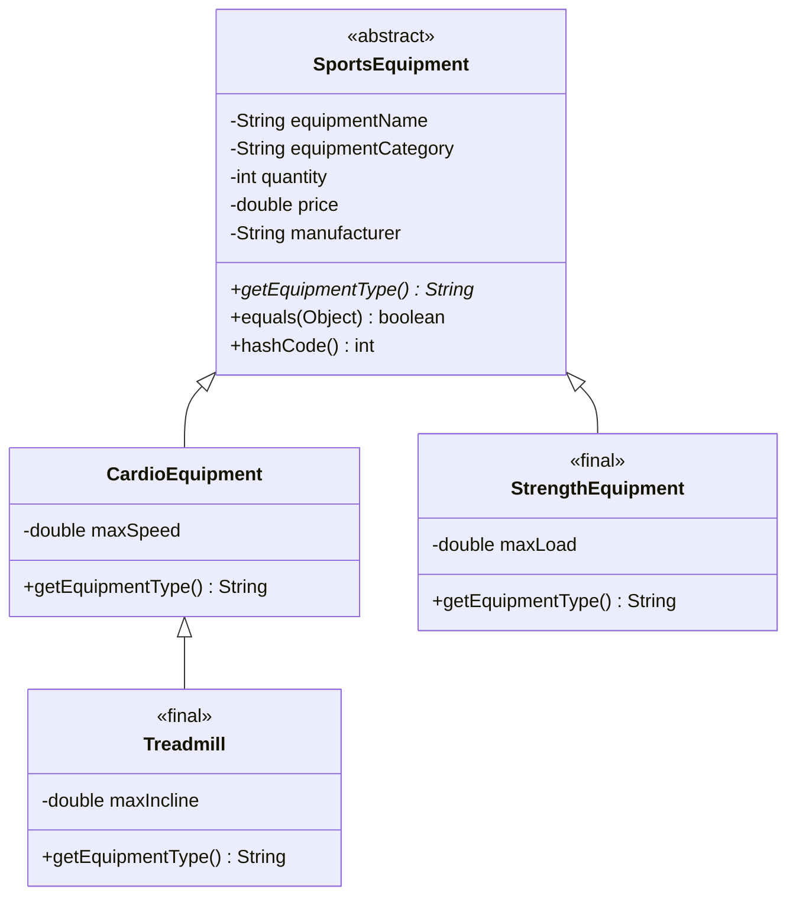

# Java2026

Laboratory works for Java

---

## 🏋️ Лабораторна робота №1

### Предметна область

Консольний застосунок для ведення обліку спортивного інвентарю.

### Сутність: Спортивний інвентар

| Характеристика | Тип | Опис |
|:---|:---:|:---|
| `equipmentName` | `String` | Назва спортивного інвентарю |
| `equipmentCategory` | `String` | Категорія інвентарю |
| `quantity` | `int` | Кількість одиниць інвентарю |
| `price` | `double` | Ціна за одну одиницю |
| `manufacturer` | `String` | Виробник інвентарю |

---

### ⚙️ Обчислювальні операції

**Загальна вартість інвентарю** визначається шляхом множення кількості одиниць на ціну однієї одиниці:

`totalCost = quantity × price`

Також програма перевіряє наявність спортивного інвентарю за його кількістю:

- якщо `quantity > 0` — інвентар є в наявності;
- якщо `quantity = 0` — інвентар відсутній.

---

### 🖥️ Форматування виводу

Для виведення інформації про спортивний інвентар використовується `System.out.printf`.

Для значень типу `double` використовується формат `%.2f`, який забезпечує відображення двох знаків після крапки.

Основні формати, використані у програмі:

| Формат | Призначення |
|:---:|:---|
| `%s` | Виведення текстового значення `String` |
| `%d` | Виведення цілого числа `int` |
| `%.2f` | Виведення дробового числа з двома знаками після крапки |
| `%n` | Перехід на новий рядок |

---

### 🚀 Запуск

Для компіляції та запуску застосунку необхідно відкрити термінал у папці проєкту та виконати команди:

```bash
javac -encoding UTF-8 Main.java
java Main
```

Команда `javac` використовується для компіляції Java-файлу, а команда `java` — для запуску скомпільованої програми.

---

### 📝 Приклад вводу

Назва інвентарю: Баскетбольний м'яч

Категорія: М'ячі

Кількість: 8

Ціна за одиницю: 750

Виробник: Spalding

---

### 📋 Приклад виводу

```text
=== СПОРТИВНИЙ ІНВЕНТАР ===

Назва: Баскетбольний м'яч
Категорія: М'ячі
Кількість: 8
Ціна за одиницю: 750.00 грн
Виробник: Spalding
Загальна вартість: 6000.00 грн
Інвентар є в наявності.
```

---

### 🛠️ Технології

- **Java** — мова програмування для реалізації консольного застосунку.
- **Scanner** — використовується для введення даних користувачем.
- **Git** — система контролю версій.
- **GitHub** — платформа для зберігання та роботи з репозиторієм.

---

## 🏋️ Лабораторна робота №2

### Предметна область

Консольний застосунок для ведення обліку спортивного інвентарю з використанням масивів, циклів, сортування та пошуку.

### 📦 Клас `SportsEquipment`

Для представлення спортивного інвентарю створено клас `SportsEquipment`.

Клас містить такі поля:

| Характеристика | Тип | Опис |
|:---|:---:|:---|
| `equipmentName` | `String` | Назва спортивного інвентарю |
| `equipmentCategory` | `String` | Категорія інвентарю |
| `quantity` | `int` | Кількість одиниць інвентарю |
| `price` | `double` | Ціна за одну одиницю |
| `manufacturer` | `String` | Виробник інвентарю |

Для створення об'єктів використовується конструктор класу.

Метод `toString()` використовується для зручного виведення інформації про об'єкт.

Метод `equals()` використовується для порівняння двох об'єктів `SportsEquipment` за їхніми характеристиками.

---

### 🔢 Масив об'єктів

У програмі створюється масив із 5 об'єктів `SportsEquipment`.

Заповнення масиву виконується за допомогою циклу `for`, а введення даних здійснюється через `Scanner`.

Для виведення всіх елементів масиву використовується цикл `for-each`.

---

### 📊 Підрахунок елементів

Програма підраховує кількість позицій спортивного інвентарю, для яких кількість одиниць не перевищує 5.

---

### 🔄 Сортування

Реалізовано сортування масиву методом бульбашки (**Bubble Sort**).

Інвентар сортується за ціною від меншої до більшої.

Сортування виконується без використання `Arrays.sort()`.

Перед та після сортування масив виводиться на екран.

---

### 🔎 Пошук

Реалізовано лінійний пошук спортивного інвентарю.

Метод `findEquipment()` отримує масив об'єктів та об'єкт для пошуку і послідовно порівнює елементи за допомогою методу `equals()`.

Якщо відповідний об'єкт знайдено, метод повертає `true`, інакше — `false`.

---

### 🚀 Запуск

Для компіляції та запуску застосунку необхідно відкрити термінал у папці проєкту та виконати команди:

```bash
javac -encoding UTF-8 Main.java SportsEquipment.java
java Main
```

---

### 🛠️ Технології

- **Java** — мова програмування для реалізації консольного застосунку.
- **Scanner** — використовується для введення даних користувачем.
- **Масиви** — використовуються для зберігання об'єктів спортивного інвентарю.
- **Цикли `for` та `for-each`** — використовуються для заповнення, обробки та виведення масиву.
- **Bubble Sort** — використовується для сортування інвентарю за ціною.
- **Лінійний пошук** — використовується для пошуку об'єкта в масиві.
- **Git** — система контролю версій.
- **GitHub** — платформа для зберігання та роботи з репозиторієм.

## Лабораторна робота №3

### Тема
Реалізація обробки винятків та створення власних підкласів Exception.

### Реалізовано

- обробку стандартного винятку `InputMismatchException`;
- обробку `ArrayIndexOutOfBoundsException`;
- використання конструкцій `try-catch-finally`;
- створення власного базового винятку `DomainException`;
- створення власного винятку `InvalidPriceException`;
- створення власного винятку `InsufficientStockException`;
- перевірку коректності ціни та кількості спортивного інвентарю;
- використання `throw` та `throws`;
- реалізацію повторного викидання винятку (`rethrow`);
- ієрархію власних винятків;
- використання кількох блоків `catch`;
- демонстрацію обробки винятків у програмі обліку спортивного інвентарю.

### Перевірені ситуації

1. Некоректне введення кількості або ціни.
2. Звернення до елемента масиву за межами його розміру.
3. Введення від'ємної ціни.
4. Введення нульової або від'ємної кількості.
5. Передача та повторне викидання власних винятків.
6. Обробка дочірніх винятків через базовий `DomainException`.

---

## 🏋️ Лабораторна робота №4

### Тема

Реалізація інтерфейсів, абстрактних класів, поліморфізму та патерна проєктування Strategy.

### 🎯 Мета роботи

Ознайомитися з інтерфейсами та абстрактними класами в Java, навчитися використовувати поліморфізм, реалізовувати кілька інтерфейсів і застосовувати патерн Strategy для зміни поведінки програми під час виконання.

### 📦 Інтерфейс `StockCheck`

Створено інтерфейс `StockCheck`, який визначає контракт для перевірки стану спортивного інвентарю.

Інтерфейс містить такі методи:

- `check(SportsEquipment item)` — перевіряє, чи відповідає інвентар певній умові;
- `getDescription()` — метод `default`, який повертає опис перевірки та може бути перевизначений у класах реалізації.

### 🔍 Реалізації інтерфейсу

Реалізовано два класи:

| Клас | Призначення |
|:---|:---|
| `LowStockCheck` | Перевіряє, чи кількість інвентарю більша за 0 та не перевищує встановлену межу `LOW_STOCK_LIMIT`. |
| `OutOfStockCheck` | Перевіряє, чи кількість інвентарю дорівнює 0. |

Обидва класи перевизначають метод `getDescription()` для відображення власного опису перевірки.

### 🔄 Поліморфізм

Для демонстрації поліморфізму створено масив `StockCheck[]`, який містить об'єкти різних реалізацій інтерфейсу.

У циклі викликається метод `check()` для кожної реалізації. Поведінка методу залежить від конкретного об'єкта.

### 🧩 Абстрактний клас `AbstractStockCheck`

Створено абстрактний клас `AbstractStockCheck`, який реалізує інтерфейс `StockCheck` та містить спільний метод `printResult()`.

Метод виконує перевірку спортивного інвентарю та виводить результат. Конкретні класи успадковують цей метод, але реалізують власні правила перевірки.

### 📋 Інтерфейс `Reportable`

Створено інтерфейс `Reportable` із методом `getReportName()`, який повертає коротку назву перевірки для звіту.

Класи `LowStockCheck` та `OutOfStockCheck` реалізують цей інтерфейс додатково до успадкування від `AbstractStockCheck`.

### ⚙️ Патерн Strategy

Реалізовано патерн проєктування Strategy за допомогою класу `StockChecker`.

Клас містить такі можливості:

- отримання початкової стратегії через конструктор;
- зберігання поточної стратегії через інтерфейс `StockCheck`;
- виконання перевірки за допомогою методу `check()`;
- отримання опису поточної стратегії через `getDescription()`;
- зміна стратегії під час виконання програми за допомогою `setStrategy()`.

Для демонстрації патерна спочатку використовується `LowStockCheck`, після чого стратегія змінюється на `OutOfStockCheck`.

### ✅ Перевірка роботи

Під час тестування використано п'ять позицій спортивного інвентарю.

Очікувані результати:

- кількість позицій із малою кількістю — 2;
- кількість позицій, відсутніх у наявності, — 1;
- для товару з кількістю 3 результат `LowStockCheck` — `true`;
- для того самого товару результат `OutOfStockCheck` — `false`.

### 🚀 Запуск

Для компіляції всіх Java-файлів у папці проєкту та запуску програми необхідно виконати команди:

```bash
javac *.java
java Main
```

### 🛠️ Технології та засоби

- **Java** — мова програмування.
- **Інтерфейси** — визначення контрактів поведінки класів.
- **Абстрактні класи** — реалізація спільної логіки.
- **Поліморфізм** — використання різних реалізацій через спільний тип.
- **Strategy** — зміна алгоритму перевірки під час виконання програми.
- **Git** — система контролю версій.
- **GitHub** — платформа для зберігання та спільної роботи з репозиторієм.


## 🏋️ Лабораторна робота №5

### Тема

Рефакторинг програмного коду із застосуванням патернів проєктування Factory, Observer та Adapter.

### 🎯 Мета роботи

Покращити архітектуру наявного консольного застосунку для обліку спортивного інвентарю шляхом застосування патернів проєктування та рефакторингу коду лабораторних робіт №1–4.

### 🏭 Патерн Factory

Для створення об'єктів перевірки стану запасів реалізовано клас `StockCheckFactory`.

Метод `createCheck(String type)` приймає тип перевірки та повертає відповідний об'єкт:

- `low` — створює `LowStockCheck`;
- `out` — створює `OutOfStockCheck`;
- невідомий тип спричиняє `IllegalArgumentException`.

Завдяки фабриці клієнтський код звертається до єдиного методу створення об'єктів, а не створює ці перевірки безпосередньо в кожному місці використання.

### 👁️ Патерн Observer

Для демонстрації сповіщення про зміну кількості спортивного інвентарю реалізовано такі класи та інтерфейси:

| Клас / інтерфейс | Призначення |
|:---|:---|
| `StockObserver` | Інтерфейс спостерігача з методом `onStockChanged()`. |
| `StockSubject` | Зберігає список спостерігачів і повідомляє їх про зміну кількості інвентарю. |
| `LowStockObserver` | Повідомляє про малу кількість інвентарю. |
| `StockLogObserver` | Виводить повідомлення про зміну кількості в журналі. |

Метод `changeQuantity()` змінює кількість інвентарю та повідомляє всіх підписаних спостерігачів, якщо значення змінилося.

Робота патерна демонструється на тестовому об'єкті спортивного інвентарю, щоб не змінювати основні дані, введені користувачем.

### 🔌 Патерн Adapter

Для демонстрації адаптації несумісних інтерфейсів реалізовано такі класи:

| Клас | Призначення |
|:---|:---|
| `LegacyStockChecker` | Імітує застарілий компонент, який перевіряє наявність інвентарю за числовою кількістю. |
| `LegacyStockCheckAdapter` | Адаптує застарілий компонент до інтерфейсу `StockCheck`. |

Адаптер реалізує метод `check(SportsEquipment item)` і передає кількість інвентарю до методу `isOutOfStock(int quantity)` класу `LegacyStockChecker`.

Несумісний клас не змінюється. Для зв'язку між компонентами використовується композиція.

### ✅ Перевірка роботи

Після внесення змін перевірено компіляцію та запуск програми.

Під час виконання демонструються:

- створення перевірок запасів за допомогою фабрики;
- сповіщення двох спостерігачів про зміну кількості тестового інвентарю;
- перевірка наявності інвентарю через адаптер;
- робота наявних можливостей застосунку, зокрема перевірок запасів і патерна Strategy.

### 🚀 Компіляція та запуск

Усі команди потрібно виконувати в терміналі з кореневої папки проєкту.

Компіляція:

```bash
javac -encoding UTF-8 -d out -sourcepath src Main.java src/*.java
```

Запуск:

```bash
java "-Dfile.encoding=UTF-8" -cp out Main
```

### 🛠️ Технології та засоби

- **Java** — мова програмування.
- **Інтерфейси та поліморфізм** — спільний контракт для різних реалізацій.
- **Factory** — централізоване створення об'єктів перевірки.
- **Observer** — сповіщення підписників про зміну стану.
- **Adapter** — узгодження несумісних інтерфейсів.
- **Strategy** — зміна алгоритму перевірки під час виконання програми.
- **Git** — система контролю версій.
- **GitHub** — платформа для зберігання репозиторію та роботи з Pull Request.

---

## 🏋️ Лабораторна робота №6

### Тема

Реалізація ієрархії класів, наслідування, поліморфізму, перевантаження конструкторів, `equals()`, `hashCode()` та pattern matching у Java.

### 🎯 Мета роботи

Закріпити навички об'єктноорієнтованого програмування, навчитися створювати ієрархії класів, використовувати абстрактні та запечатані класи, перевизначати методи `equals()` і `hashCode()`, а також застосовувати pattern matching.

### 📦 Ієрархія класів

У програмі реалізовано такі класи:

- `SportsEquipment` — абстрактний базовий клас зі спільними полями спортивного інвентарю.
- `CardioEquipment` — клас кардіотренажерів, який містить поле `maxSpeed`.
- `StrengthEquipment` — клас силового обладнання, який містить поле `maxLoad`.
- `Treadmill` — клас бігових доріжок, який успадковує `CardioEquipment` і містить поле `maxIncline`.

Спільні поля оголошено як `private`. Для ініціалізації успадкованих полів використовується `super(...)`, а для перевизначення методів — анотація `@Override`.

### 🔒 Ключові слова `abstract`, `sealed` і `final`

- `abstract` означає, що базовий клас не призначений для безпосереднього створення об'єктів.
- `sealed` обмежує перелік класів, які можуть безпосередньо успадковувати клас.
- `permits` визначає дозволені підкласи.
- `final` забороняє подальше успадкування класу.

У цій ієрархії `SportsEquipment` дозволяє успадкування класам `CardioEquipment` і `StrengthEquipment`. Клас `CardioEquipment` дозволяє успадкування лише класу `Treadmill`. Класи `StrengthEquipment` і `Treadmill` є `final`.

### 🔧 Перевантаження конструкторів

У класі `CardioEquipment` реалізовано два конструктори: один приймає спільні параметри, а інший додатково приймає максимальну швидкість.

Для повторного використання коду застосовується `this(...)`, який викликає інший конструктор цього самого класу.

Виклик `super(...)` передає спільні параметри базовому класу. Порядок виконання конструкторів демонструється повідомленнями в консолі.

### 🔄 Поліморфізм і pattern matching

Для роботи з різними видами інвентарю використовується спільний тип `SportsEquipment`.

У програмі демонструються:

- `instanceof` із pattern matching для визначення конкретного типу об'єкта;
- `switch` із pattern matching для отримання інформації про відповідний вид обладнання;
- використання специфічних методів підкласів безпосередньо після перевірки типу.

### ⚖️ Методи `equals()` і `hashCode()`

Метод `equals()` порівнює об'єкти за значеннями їхніх полів, а `hashCode()` обчислює хеш-код об'єкта.

Метод `equals()` використовує `getClass()` для перевірки однаковості фактичних типів об'єктів. Це запобігає порівнянню об'єктів різних класів як рівних.

Для перевірки створюються два однакові об'єкти `Treadmill`. Програма демонструє результати порівняння в обох напрямках і перевіряє збіг хеш-кодів.

### 🧩 Композиція та наслідування

Композиція використовується в патерні Adapter: `LegacyStockCheckAdapter` містить об'єкт `LegacyStockChecker` і делегує йому перевірку.

Цей підхід дозволяє використовувати застарілий компонент без зміни його класу. Наслідування застосовується там, де класи справді є спеціалізованими видами спортивного інвентарю.

### 📊 Діаграма класів



### 🚀 Компіляція та запуск

Команди виконуються в кореневій папці проєкту `E:\Java2026`.

Компіляція:

```powershell
javac -encoding UTF-8 -d out Main.java src\*.java
```

Запуск:

```powershell
java -cp out Main
```

### 🛠️ Технології та засоби

- **Java** — мова програмування.
- **Наслідування та поліморфізм** — повторне використання коду й робота зі спільним типом.
- **`abstract`, `sealed`, `permits`, `final`** — керування ієрархією класів.
- **`equals()` і `hashCode()`** — порівняння об'єктів та обчислення хеш-кодів.
- **Pattern matching** — визначення типу об'єкта та робота з ним.
- **Mermaid** — створення діаграми класів.
- **Git і GitHub** — контроль версій і зберігання проєкту.

